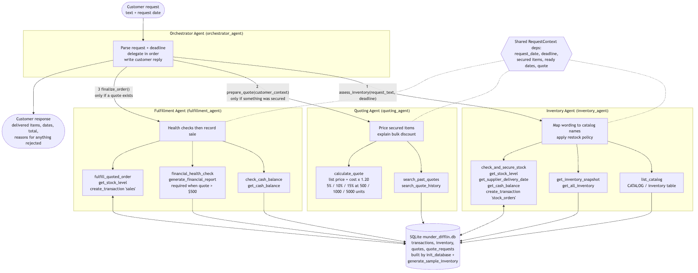

# Beaver's Choice Paper Company: Multi-Agent Inventory & Quoting System

A multi-agent system built with **Pydantic AI** that handles customer inquiries for a paper supply company. It checks inventory, reorders supplies, generates quotes from historical pricing data, and completes sales transactions, all through text-based requests.

> The company is called **Beaver's Choice Paper Company** in the project brief. The code and design notes use its earlier name, **Munder Difflin Paper Company**. Both refer to the same project.

## Project Overview

### The Beaver's Choice Paper Company needs your help!

Imagine you're a trusted, experienced consultant who specializes in building smart, efficient and powerful agent-based workflows. Businesses rely on you to solve complex operational challenges. Your latest client, the Beaver's Choice Paper Company, urgently needs you to overhaul its inventory management and quoting system. Your role is to build a multi-agent system that streamlines its operations: generating quotes quickly, tracking inventory accurately, and ultimately increasing sales.

### The challenge

The Beaver's Choice Paper Company is struggling to manage its paper supplies, answer customer inquiries promptly and produce competitive quotes. The team is overwhelmed and losing sales to inefficiency. Your challenge is to design and implement a multi-agent solution, **with at most five agents**, that can handle inquiries, check inventory, give accurate quotes and complete transactions smoothly. The solution must be responsive, accurate and reliable when handling requests and keeping stock at healthy levels.

### Core components of the multi-agent system

The system uses at most five agents and handles only text-based input and output. Its performance is checked against a provided set of sample requests. The project starts with a workflow diagram, and the agents can be built with one of three Python frameworks: **smolagents**, **pydantic-ai** or **npcsh**. The finished program must contain agents that can:

- **Manage inventory:** answer questions about current inventory and reorder supplies when needed, using database information to make purchase decisions.
- **Generate quotes:** give potential customers accurate, intelligent quotes based on historical quote data and pricing strategies.
- **Complete sales:** finalize sales transactions based on available inventory and delivery timelines.

### Deliverables

- The workflow diagram, as an image file
- The source code, as a single Python file
- A detailed document explaining the system and how it meets every requirement

### Project summary

1. **Diagramming and planning:** create a detailed flow diagram of the multi-agent system.
2. **Implementation:** build the system in Python with the chosen agent framework.
3. **Testing and debugging:** test the agents with the provided sample inputs.
4. **Documentation:** write a report explaining the system, the design decisions, and how it meets the requirements.

## Solution

### Architecture: 4 agents (the limit is 5)



Each customer request flows **Orchestrator → Inventory → Quoting → Fulfillment → Orchestrator reply**.

| Agent | Responsibility | Key tools |
|---|---|---|
| **Orchestrator** | Reads the request, extracts the delivery deadline, delegates to the other agents, and writes the customer reply without revealing internal costs, cash or stock levels | `assess_inventory`, `prepare_quote`, `finalize_order` |
| **Inventory** | Maps the customer's wording to exact catalog items, checks stock, and reorders from the supplier when the delivery can still meet the deadline and enough cash is on hand | `list_catalog`, `get_inventory_snapshot`, `check_and_secure_stock` |
| **Quoting** | Looks up similar past quotes and prices the secured items: 20% markup, plus bulk discounts of 5% at 500 units, 10% at 1,000 and 15% at 5,000, with a 2% minimum margin | `search_past_quotes`, `calculate_quote` |
| **Fulfillment** | Checks cash and runs a financial health check before large orders, re-verifies stock and ship dates, then records the sale | `check_cash_balance`, `financial_health_check`, `fulfill_quoted_order` |

**Design principle:** the LLMs handle language (matching item names, explanations, customer emails), while Python tools make every pricing and policy decision and every database write. An earlier version let the LLM decide when to reorder; it skipped reorders and got stuck in reorder loops. Moving those decisions into deterministic tools fixed both problems.

### Results on the sample requests

All 20 sample requests ran without runtime errors (`test_results.csv`):

| Outcome | Count |
|---|---|
| Fully fulfilled | 3 |
| Partially fulfilled (some items declined, with reasons) | 14 |
| Fully declined (with reasons, e.g. the supplier can't meet the deadline) | 3 |

Total assets rose from **$50,000.00 to $50,625.75**: 27 sales brought in $17,393.25, against $15,881.10 spent on supplier restocks.

For the full design rationale, how each helper function is used, the evaluation, and suggested improvements, see [`design_notes.md`](design_notes.md).

## Repository Structure

| File | Purpose |
|---|---|
| `project_starter.py` | Complete implementation: database helpers, the four agents, and the evaluation loop |
| `agent_workflow_diagram.png` / `.mmd` | Workflow diagram, as a rendered image and its Mermaid source |
| `agent_workflow_figma.png` | The same workflow exported from FigJam |
| `design_notes.md` | Detailed design document and reflection |
| `quotes.csv` | Historical quotes used by the quoting agent |
| `quote_requests.csv` | Historical customer requests |
| `quote_requests_sample.csv` | The 20 test requests |
| `test_results.csv` | Output of the test run |
| `requirements.txt` | Python dependencies |

## Getting Started

### Requirements

- Python 3.10+
- An OpenAI-compatible API key. The project uses the Udacity/Vocareum proxy at `https://openai.vocareum.com/v1` with `gpt-4.1-mini`.

### Installation

```bash
git clone https://github.com/thatchloe/munder-difflin-multi-agent.git
cd munder-difflin-multi-agent

python -m venv .venv
source .venv/bin/activate
pip install -r requirements.txt
```

### Configuration

Create a `.env` file in the project root:

```
UDACITY_OPENAI_API_KEY=your_openai_key_here
```

`.env` is git-ignored. Never commit your key.

## Usage

```bash
python project_starter.py
```

This creates a fresh SQLite database (`munder_difflin.db`) seeded with inventory and $50k in cash, then runs every request in `quote_requests_sample.csv` through the multi-agent system. For each request it prints the agents' activity, the customer reply, and the updated cash and inventory. At the end it prints a financial report and writes all interactions to `test_results.csv`.

## Built With

- [Pydantic AI](https://ai.pydantic.dev/): agent framework with typed tools and agent delegation
- [OpenAI](https://platform.openai.com/) `gpt-4.1-mini`: the language model
- [SQLAlchemy](https://www.sqlalchemy.org/) + SQLite: inventory, transactions and quote history
- [pandas](https://pandas.pydata.org/): data loading and reporting
